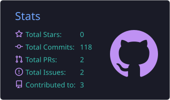
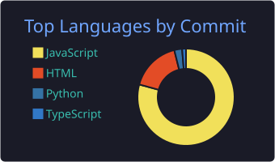
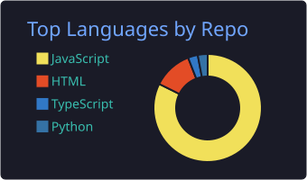
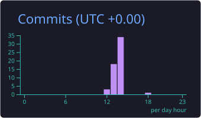

  

  

  
  
  
  

---

## 🧑‍💻 Sobre mim

Um cara comum que curte **tecnologia, academia, games e animes**.
Atualmente estudando **Python** e **Java**, com foco em desenvolvimento backend.

 

  
  &nbsp;&nbsp;&nbsp;&nbsp;&nbsp;&nbsp;
  

 

---

## 🛠️ Tech Stack

  
  &nbsp;&nbsp;&nbsp;
  
  &nbsp;&nbsp;&nbsp;
  
  &nbsp;&nbsp;&nbsp;
  
  &nbsp;&nbsp;&nbsp;
  

---

## 🎯 Objetivos

- 🐍 Evoluir como desenvolvedor backend em Python
- ☕ Aprofundar meus conhecimentos em Java
- 🚀 Construir projetos reais e publicar aqui no GitHub

---

## 📊 GitHub Stats

  
  &nbsp;&nbsp;
  

  
  &nbsp;&nbsp;
  

  

---

## 📫 Vamos conversar!

  
  &nbsp;
  
  &nbsp;
  

  

